# Gripline Lite 1.0 for Forza Horizon 1: ReImagined

**More immersion for Forza Horizon 1, built into [Forza Horizon 1: ReImagined](https://github.com/FH1-ReImagined/ForzaHorizon1-ReImagined).**
Everything can be changed live in game with **F6**, without restarting.

| Feature | What it does |
| --- | --- |
| **1:1 steering wheel** | The in-car wheel turns exactly as far as your real wheel (900° by default, 180–1080° adjustable). Off = stock FH1. |
| **Hide hands** | With the 1:1 wheel, the driver's hands can be hidden (they cannot follow 900°). |
| **Dashboard Cam** | An extra camera after the in-car view, in front of the wheel, wheel and hands hidden. Forward/back, up/down and tilt are adjustable. |
| **Walking** | Get out of the stopped car and walk around (F / left stick press), with fade, door sounds, collision and a walking HUD. Offline only. |
| **Traffic** | Civilian traffic: Off, Less, Normal, More, Lots, Maximum. |
| **Drivatars** | The same for the Drivatars in free roam. |

Gripline Lite is the little brother of [Gripline](../README.md) for Forza Horizon 2.

## Install

You need ReImagined installed and built once with its launcher (Title Update 4).

1. Download **`Gripline Lite Installer 1.0.exe`** from the Releases page.
2. Close the game and double-click it. Windows may say "Windows protected your PC" (the file
   is not code-signed): click **More info › Run anyway**. Click **Install**. It finds ReImagined by itself; if not, choose the
   `...\ForzaHorizon1-ReImagined\project\forza-recomp` folder.
3. Open the ReImagined launcher: **Setup › Build › Rebuild**. The first build takes a while;
   later updates of Gripline Lite only rebuild a few files (about a minute).
4. Play. Press **F6** for the Gripline menu.

**After every ReImagined update**, run the installer again (it shows
"removed by a ReImagined update") and press Rebuild, which the update needs anyway.

**Remove:** run the installer, click **Remove**, then Rebuild once more.

## In game

| Key | |
| --- | --- |
| **F6** | Gripline menu (Up/Down select, Left/Right change, F6/Esc close). Works with arrow keys and the d-pad. |
| **F** / **left stick press** | Walking: get out of the stopped car; near the car, get back in. WASD / left stick walk, mouse / arrows / right stick look, Shift / RT run, Ctrl / B crouch, Space / A jump. |
| **Change camera** (wheel: Back/View, pad: RB, keyboard: Tab or 3) | In the in-car view: Dashboard Cam. Once more: the next camera as usual. |

Settings are saved to `gripline.ini` in ReImagined's `runtime` folder.
Traffic and Drivatar levels apply in free roam; races and online sessions keep the game's own traffic.

## How it works

The installer copies the Gripline Lite source files to `project\forza-recomp\src\hooks\` and adds
lines to `CMakeLists.txt`, `src\kernel\input_autopress.cpp` and `src\platform\hud_overlay.cpp`; every added line is marked
`Gripline Lite`, and those files are backed up to `project\forza-recomp\gripline-lite-backup\`
first. ReImagined's launcher then compiles them into the game. No game files are included or
changed, nothing is downloaded. When it opens, the installer only asks GitHub whether a newer Gripline Lite release exists and shows a link to it.

| File | |
| --- | --- |
| `gripline_wheel.cpp` | Raises the cockpit wheel's fixed ±90° limit to half the wheel rotation and sets the wheel's angle scale to 1.0 (stock 0.75). |
| `gripline_dashcam.cpp` | Dashboard Cam (moves the in-car view after the camera director's step), hides wheel and hands, the camera button. |
| `gripline_traffic.cpp` | Scales the AI spawner's tunables (MaxTraffic/MinTraffic, MaxFestival/MinFestival, spawn intervals). |
| `gripline_walking.cpp` | Walking (camera at the walker's eye, the game's collision world, fade, door sounds, walking HUD). |
| `gripline_menu.cpp` | The F6 menu (ReImagined's HUD overlay) and `gripline.ini`. |

## Credits and license

- [Forza Horizon 1: ReImagined](https://github.com/FH1-ReImagined/ForzaHorizon1-ReImagined) (GPL-3.0) – the recompilation this builds on. Gripline Lite is an **unofficial** add-on, not made by the ReImagined team.
- Door sounds: Sounds From The Lab (royalty-free).
- Gripline Lite by Flenkii, GPL-3.0-or-later (see [LICENSE](../LICENSE)).
- Forza Horizon is a trademark of Microsoft. You need your own copy of the game.

---

## Deutsch (kurz)

**Gripline Lite** bringt Lenkrad 1:1 (900°), Hände ausblenden, Dashboard Cam, Walking (aussteigen mit F)
und einstellbaren Verkehr in Forza Horizon 1: ReImagined. Alles live im Spiel mit **F6**.

1. Spiel schließen, **`Gripline Lite Installer 1.0.exe`** starten (bei der Windows-Warnung: Weitere Informationen › Trotzdem ausführen), **Installieren**.
2. ReImagined-Launcher: **Setup › Build › Rebuild**.
3. Im Spiel **F6** drücken.

Nach jedem ReImagined-Update den Installer noch einmal starten und Rebuild drücken.
Entfernen: Installer › **Entfernen**, dann Rebuild.
